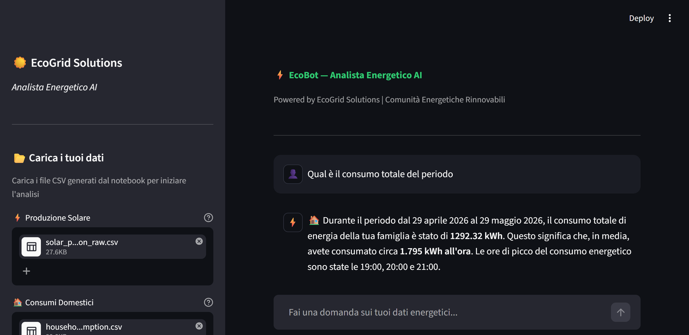
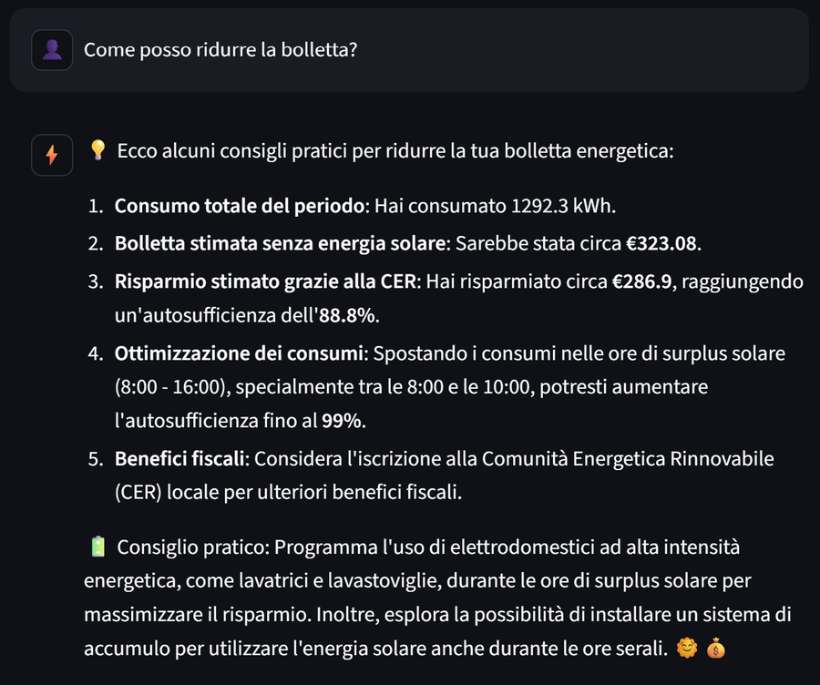
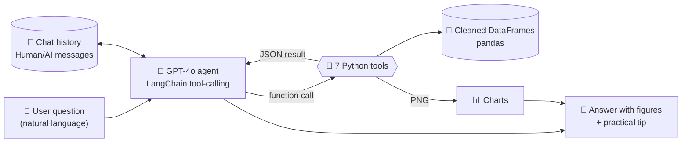
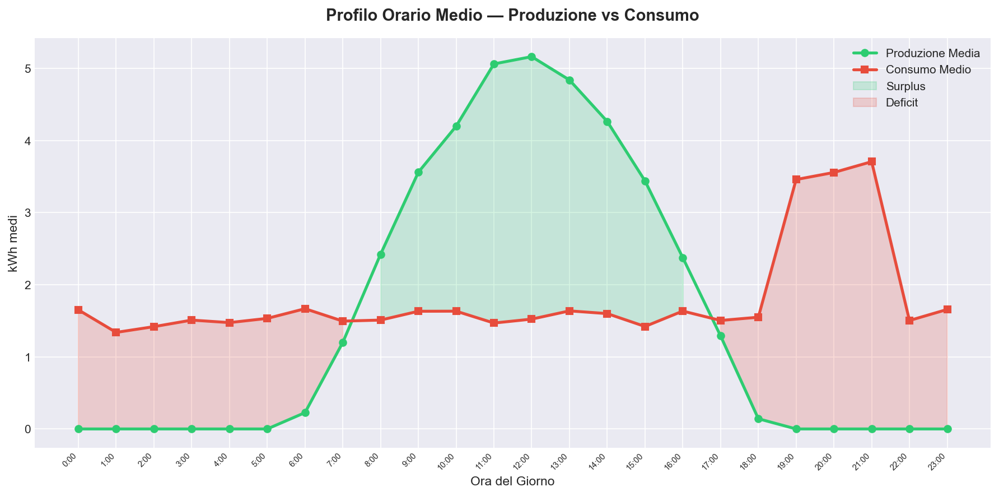

# ⚡ EcoBot — AI Energy Analyst Agent

**An LLM agent that turns raw smart-meter data into clear answers and practical energy-saving advice for families in a Renewable Energy Community.**




> The user interface, the notebook and the agent's answers are in **Italian**, the language of the target users.

---

## Table of Contents

1. [Project Overview](#project-overview)
2. [Business Problem](#business-problem)
3. [Solution & Key Features](#solution--key-features)
4. [Architecture](#architecture)
5. [Dataset](#dataset)
6. [Methodology](#methodology)
7. [Results & Insights](#results--insights)
8. [Tech Stack](#tech-stack)
9. [Getting Started](#getting-started)
10. [Example Questions](#example-questions)
11. [Project Structure](#project-structure)
12. [Testing & Verification](#testing--verification)
13. [Limitations](#limitations)
14. [Future Improvements](#future-improvements)
15. [Author](#author)

---

## Project Overview

**EcoBot** is a conversational AI agent acting as a virtual energy analyst for *EcoGrid Solutions*, a fictional
start-up that manages **Renewable Energy Communities (CER — Comunità Energetiche Rinnovabili)** in Italy.

A user asks a question in natural language — *"Was there a sensor failure?"*, *"Am I energy self-sufficient?"*,
*"When should I run the washing machine?"* — and the agent (GPT-4o orchestrated with LangChain) **autonomously
decides which Python tools to call**, computes the answer with pandas on the actual data, generates charts with
matplotlib, and replies with precise figures plus at least one practical, personalised tip.

The project has two deliverables:

| Deliverable | Description |
|---|---|
| [`agent.ipynb`](agent.ipynb) | Step-by-step development: synthetic IoT dataset, data cleaning, 7 tools, agent configuration and 6 conversational tests with the agent's visible reasoning trace |
| [`app.py`](app.py) | **Streamlit** web app: CSV upload, KPI sidebar, chat with conversational memory, charts rendered directly in the conversation |

`app.py` is generated by the notebook itself (`%%writefile` cell), so the notebook is the single source of truth.

## Business Problem

Households in an energy community receive **hourly IoT data** about their solar production and consumption, but
raw kWh time series are hard to interpret for non-technical users. This leads to three concrete problems:

1. **Missed savings** — families consume most of their energy in the evening, when solar panels produce nothing,
   and don't know how to shift their loads to the sunny hours.
2. **Undetected data-quality issues** — sensor failures (missing readings, impossible negative values) silently
   distort reports and billing estimates.
3. **Customer-care overload** — the same questions ("why is my bill high?", "is a battery worth it?") are answered
   manually, one customer at a time.

**Goal:** give every household a 24/7 analyst that answers in plain language, is grounded in their own data, and
turns numbers into actions that increase self-consumption and reduce the energy bill.

## Solution & Key Features

- 🤖 **Tool-calling agent** — GPT-4o picks among 7 specialised tools via native OpenAI function calling.
- 🧮 **Numbers computed by code, not by the LLM** — every figure comes from deterministic pandas functions that
  return JSON; the LLM only interprets it. This keeps answers verifiable and limits numeric hallucinations.
- 🧹 **Data-quality pipeline** — detection and correction of missing values, negative readings, duplicates,
  time gaps and statistical outliers.
- 📊 **On-demand charts** — 4 chart types generated as PNG and shown inline in the chat.
- 💡 **Personalised advice** — peak shifting, battery storage evaluation, bill-saving estimates.
- 🧠 **Conversational memory** — follow-up questions such as *"and what about the weekly trend?"* keep context.
- 🛡️ **Guardrails** — iteration limit, execution timeout, parsing-error handling, low temperature (0.3) and
  graceful error messages in the UI.



*Real GPT-4o session in the Streamlit app (captured on an earlier run of the dataset generator, hence slightly
different figures from those in [Results](#results--insights)).*

## Architecture



**Design decisions**

| Decision | Rationale |
|---|---|
| **Single agent** instead of multi-agent | The domain is well bounded; the complexity lives in the tools, not in the orchestration. A multi-agent system would add latency, cost and debugging effort without benefits. |
| **OpenAI tools agent** instead of text-based ReAct | Native function calling returns structured JSON, so it is more reliable than parsing free-text *Thought / Action / Observation* blocks. |
| **Tools return JSON** | Structured, unambiguous output that the LLM can read and cite. |
| **Chart path read from `intermediate_steps`** | The image to display is taken from the tool's actual output, not from the LLM's text (with a regex fallback). |
| **System prompt with a 5-step reasoning method** | Understand → choose tools → execute → interpret → answer with a practical tip; plus operational rules and a friendly, jargon-free tone. |

### Agent tools

| Tool | What it does |
|---|---|
| `load_and_clean_data` | Loads the CSVs and returns a data-quality report |
| `calculate_solar_production` | Total, daily and weekly production statistics, peak production hour |
| `calculate_consumption` | Total, daily, hourly and weekly consumption, peak consumption hours |
| `detect_anomalies` | Missing values, negative readings, 3σ outliers and time gaps in the **raw** sensor data |
| `compare_production_vs_consumption` | Energy balance, surplus/deficit days, coverage ratio |
| `plot_energy_chart` | `daily_comparison`, `hourly_pattern`, `weekly_surplus`, `production_timeseries` |
| `get_energy_advice` | Advice focused on `general`, `peak_shifting`, `storage` or `savings` |

## Dataset

Hourly consumption data reveals personal habits (when people are at home, wake up, go to sleep), so the project
uses a **synthetic but realistic dataset**, generated in the notebook with a fixed seed and a fixed end date, which
makes it **fully reproducible**.

| File | Rows | Columns | Generation model |
|---|---|---|---|
| [`data/solar_production_raw.csv`](data/solar_production_raw.csv) | 720 (30 days, hourly) | `timestamp`, `kwh_produced` | Sine curve centred on midday, `max(0, 5·sin((h−6)·π/12) + N(0, 0.5))`, zero at night |
| [`data/household_consumption.csv`](data/household_consumption.csv) | 720 (30 days, hourly) | `timestamp`, `kwh_consumed` | Base load `N(1.5, 0.5)` kWh/h + **evening peak** of +2 kWh between 19:00 and 21:00 |

**Injected anomalies** (to prove the cleaning pipeline works): 6 missing readings (broken sensor, rows 100–105)
and 1 negative value of −5 kWh (calibration error, row 200).

## Methodology

### 1. ETL & data cleaning
1. **Extract** — CSV ingestion with timestamp parsing (notebook: from disk; app: from the upload widget).
2. **Transform**
   - negative production/consumption values → `NaN` (physically impossible);
   - `NaN` → **linear interpolation**, the natural choice for continuous time series;
   - remaining edge `NaN` → `0` for production (night), period mean for consumption;
   - duplicate timestamps removed, chronological order enforced.
3. **Load** — cleaned DataFrames kept in memory (global state in the notebook, `st.session_state` in the app)
   and shared by all tools; production and consumption are joined on `timestamp`.

### 2. Data quality & anomaly detection
Run on the **raw** data: missing-value and negative-value counts, outliers above *mean + 3σ*, and missing hours
detected by comparing the timestamps with a complete hourly `date_range`.

### 3. Exploratory analysis & KPIs
Aggregations by hour of day, day and ISO week; total production and consumption; peak hours; energy balance
(surplus/deficit); days in surplus vs deficit; a coverage ratio; economic estimates at a flat tariff of 0.25 €/kWh.

### 4. Visualisation
Grouped bar chart (production vs consumption, last 14 days), average hourly profile with shaded surplus/deficit
areas, diverging weekly surplus/deficit bars and a daily production time series.

### 5. LLM orchestration
`ChatOpenAI(model="gpt-4o", temperature=0.3)` + `create_openai_tools_agent` + `AgentExecutor`
(`max_iterations=10`, `max_execution_time=120`, `handle_parsing_errors=True`, `return_intermediate_steps=True`).
Conversation memory is a plain list of `HumanMessage` / `AIMessage` objects injected through a `MessagesPlaceholder`.

## Results & Insights

Figures computed by the agent's tools on the project dataset (6 May → 5 June 2026, 720 hourly records):

| Metric | Value |
|---|---|
| Total solar production | **1,145.31 kWh** — average peak at 12:00 (~5.2 kWh/h) |
| Total household consumption | **1,292.32 kWh** — peak hours 19:00, 20:00, 21:00 (~3.5–3.7 kWh/h) |
| Net energy balance | **−147 kWh** (deficit) — 28 days in deficit, 3 in surplus |
| Coverage ratio (production ÷ consumption) | **88.6 %** |
| Hours with average solar surplus | 08:00 → 16:00 |
| Sensor anomalies detected and corrected | 6 missing values + 1 negative reading, 0 time gaps |



**Key insights**

- ☀️ **The issue is *when* energy is used, not *how much* is produced.** Production covers ~89 % of the period's
  consumption, yet the household is in deficit 28 days out of 31 because demand peaks at 19–21, after sunset.
- 🔄 **Load shifting is the cheapest lever**: moving appliances (washing machine, dishwasher, water heater) into the
  08:00–16:00 window uses energy that would otherwise be exported to the grid.
- 🔋 **A battery has a strong case**: on an hour-by-hour basis, about 648 kWh of daytime surplus is exported while
  about 795 kWh is drawn from the grid in the evening and at night (see [Limitations](#limitations)).
- 🛠️ **Data quality matters**: the broken-sensor readings were detected and repaired before any KPI was computed.

## Tech Stack

| Area | Tools |
|---|---|
| Language | Python 3.10+ (tested on 3.12) |
| LLM & agents | OpenAI GPT-4o, LangChain 0.3 (`langchain`, `langchain-openai`, `langchain-core`) |
| Data | pandas, NumPy |
| Visualisation | matplotlib |
| Web app | Streamlit |
| Development | Jupyter Notebook, nbclient, python-dotenv |

## Getting Started

### Prerequisites
- Python **3.10+**
- An **OpenAI API key** with access to `gpt-4o`

### 1. Clone and install

```bash
git clone https://github.com/oskarles-data/ecobot-energy-ai-agent.git
cd ecobot-energy-ai-agent
python -m venv .venv
```

Activate the virtual environment — Windows: `.venv\Scripts\activate` · macOS/Linux: `source .venv/bin/activate` — then:

```bash
pip install -r requirements.txt
```

> LangChain is pinned to the **0.3.x** line on purpose: `AgentExecutor` and `create_openai_tools_agent` were
> removed from `langchain.agents` in LangChain 1.x.

### 2. Configure the API key

Copy `.env.example` to `.env` and insert your key:

```bash
OPENAI_API_KEY=sk-your-key-here
```

`.env` is git-ignored and must never be committed.

### 3. Run the notebook

```bash
jupyter notebook agent.ipynb
```

Run the cells top to bottom. To execute the whole notebook headlessly and save all outputs (the `pip install`
and `streamlit run` cells are skipped automatically):

```bash
python esegui_notebook.py
```

### 4. Run the Streamlit app

```bash
streamlit run app.py
```

Open <http://localhost:8501>, upload `data/solar_production_raw.csv` and `data/household_consumption.csv` from the
sidebar, then start chatting (or use the quick-question buttons).

## Example Questions

| Category | Question (Italian) | What EcoBot does |
|---|---|---|
| Data quality | *"C'è stato un guasto ai sensori?"* | Reports the missing and negative readings found in the raw data and how they were fixed |
| Analysis | *"Qual è il consumo totale del periodo?"* | Total kWh, hourly average, peak hours |
| Comparison | *"Sono autosufficiente energeticamente?"* | Energy balance, surplus/deficit days, coverage ratio |
| Visualisation | *"Genera il grafico del profilo orario"* | Creates and displays `hourly_pattern.png` |
| Advice | *"Quando conviene usare la lavatrice?"* | Identifies the solar-surplus hours and suggests time slots |
| Memory | *"E la situazione settimanale?"* (follow-up) | Keeps the context of the previous question |

## Project Structure

```
ecobot-energy-ai-agent/
├── agent.ipynb              # Development notebook: dataset, cleaning, tools, agent, 6 conversational tests
├── app.py                   # Streamlit web app (generated by the notebook's %%writefile cell)
├── esegui_notebook.py       # Executes the notebook headlessly and saves its outputs (nbclient)
├── requirements.txt         # Pinned dependency ranges
├── .env.example             # Template for the OpenAI API key
├── data/
│   ├── solar_production_raw.csv
│   └── household_consumption.csv
├── charts/                  # Charts generated by the agent during the notebook tests
└── docs/                    # Screenshots used in this README
```

## Testing & Verification

The project was reviewed and re-verified before publication:

| Check | Result |
|---|---|
| Clean install from `requirements.txt` in a fresh virtual environment (Python 3.12, Windows 11) | ✅ No dependency conflicts (`pip check`), with LangChain 0.3.30, pandas 3.1, NumPy 2.5, Streamlit 1.67 |
| Offline test of the cleaning functions and all 7 tools of `app.py` (no API calls) | ✅ 23/23 checks passed; totals match the notebook (1,145.31 / 1,292.32 kWh, 88.6 %) |
| Streamlit app end-to-end (launch, CSV upload, KPI sidebar, chat, error handling with an unreachable LLM endpoint) | ✅ Works |
| Dataset generator reproducibility | ✅ Regenerates the published CSV values bit-for-bit |
| `app.py` identical to the notebook's `%%writefile` cell | ✅ |
| Live GPT-4o conversations | ⚠️ Not re-run during the review: the conversation outputs in the notebook come from the original run |
| Python 3.10 / 3.11 | ⚠️ Not tested (only Python 3.12 was available) |

## Limitations

- **Coverage ratio vs real self-sufficiency.** The "autosufficienza" KPI is computed as
  `min(production, consumption) / consumption` over the whole period (88.6 %). This **net** ratio implicitly assumes
  that midday energy can cover evening consumption (perfect storage or net metering). Computed **hour by hour**,
  only ~38.5 % of consumption is covered by simultaneous solar production. As a consequence, the bill-saving
  estimate is optimistic, and the `storage` advice reports a "0 kWh surplus" even though ~648 kWh of daytime
  surplus is exported. This is especially relevant in Italian energy communities, where incentives depend on energy
  shared on an hourly basis.
- **Flat tariff** of 0.25 €/kWh, with surplus valued at the purchase price; battery size and ROI in the advice are
  fixed reference values, not computed.
- **Weekly aggregation** by ISO week number: the first and last weeks are partial (102 and 114 hours) and week
  numbers restart at year boundaries.
- **Outlier detection** uses a global 3σ threshold on a series that is zero at night, so it is not sensitive; a
  baseline by hour of day would work better. Anomaly detection covers production data only.
- **Synthetic data**: no seasonality, weather effects or weekday/weekend patterns.
- **Code duplication**: the tools exist both in the notebook (global state) and in `app.py` (Streamlit session
  state), by design of the `%%writefile` workflow.
- **LangChain 0.3 legacy API**: `AgentExecutor` is not available in LangChain 1.x.

## Future Improvements

- Hourly self-sufficiency and self-consumption KPIs, with battery sizing simulated on the hourly surplus.
- Move the tools into a shared Python module used by both the notebook and the app, with a `pytest` suite.
- Migrate the agent to LangGraph / LangChain 1.x.
- Use real data (e.g. PVGIS solar estimates and smart-meter exports) with seasonality and weather.
- Hour-of-day anomaly baselines and consumption-side anomaly checks.
- Configurable tariffs (time-of-use bands, feed-in and CER incentives).
- Cost, latency and token monitoring for the LLM calls; deployment on Streamlit Community Cloud.

## Author

**Oskar Les** — [GitHub @oskarles-data](https://github.com/oskarles-data)

Developed as the final project of the *AI Agents for Data* course (Start2Impact, AI Engineer track), based on a
simulated business case (*EcoGrid Solutions*).
